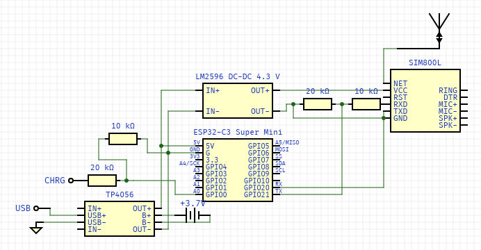

# Оповіщення про стан електропостачання через ESP32 та суміжні модулі
## Гілки
На час 13.09.24, ми маємо **2** гілки.
- [main](https://github.com/Iced-Coded/electro-arduino), це основна, релізна гілка, в яку дуже рідко вносяться зміни.
- [pre-release](https://github.com/Iced-Coded/electro-arduino/tree/pre-release), це дебаг гілка, де тестуються усі інші (feature) гілки.
## Матеріали
На даний момент, планується використання таких матеріалів:
- [ESP32-C3 Type-C](https://arduino.ua/prod6618-mikroplata-esp32-c3-type-c-12-gpio), головна міскросхема яка буде "мізками" усієї збірки; Включає у собі Wi-Fi, Bluetooth 5 та 802.11b/g/n. 
- [GSM модуль SIM800L](https://arduino.ua/prod1665-gsm-modyl-na-sim800l), модуль стільникового зв'язку, котрий буде забезпечувати зв'язок в незалежності від домашньої мережі; Включає у собі 2G та *можливо* радіо.
- [понижуючий конвертер LM2596](https://arduino.ua/prod650-dc-dc-ponijyuchii-konverter-lm2596-z-4-5-40v-do-3-35v), модуль який знизить вольтаж який буде йти до SIM800L, так як попередній модуль може згоріти за стандартної напруги від модуля зарядки.
- [Зарядний модуль TP4056 Type-C](https://arduino.ua/prod4517-zaryadnii-modyl-tp4056-type-c-s-fynkciei-zashhiti-akkymylyatora), зарядний модуль з захистом акумулятора, видає 5В.
- Та інші деталі, список яких буде доповнюватися.
## Список використаних модулів
- machine (MicroPython): https://micropython.org/
- sim800: https://github.com/basanovase/sim800
## Схематика проєкту

